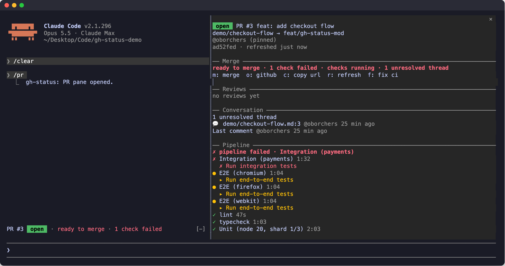
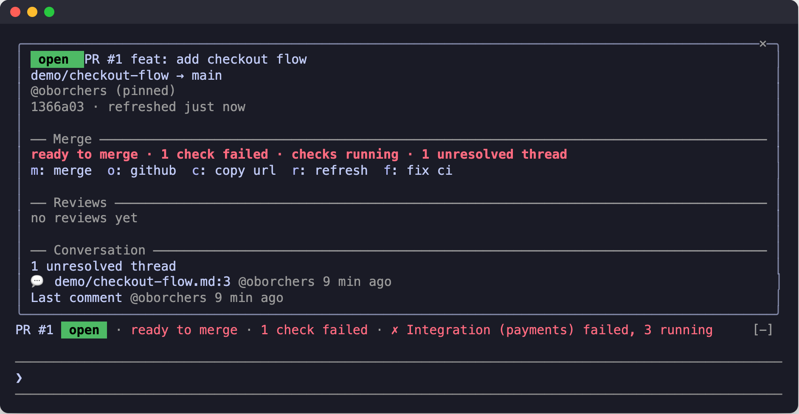
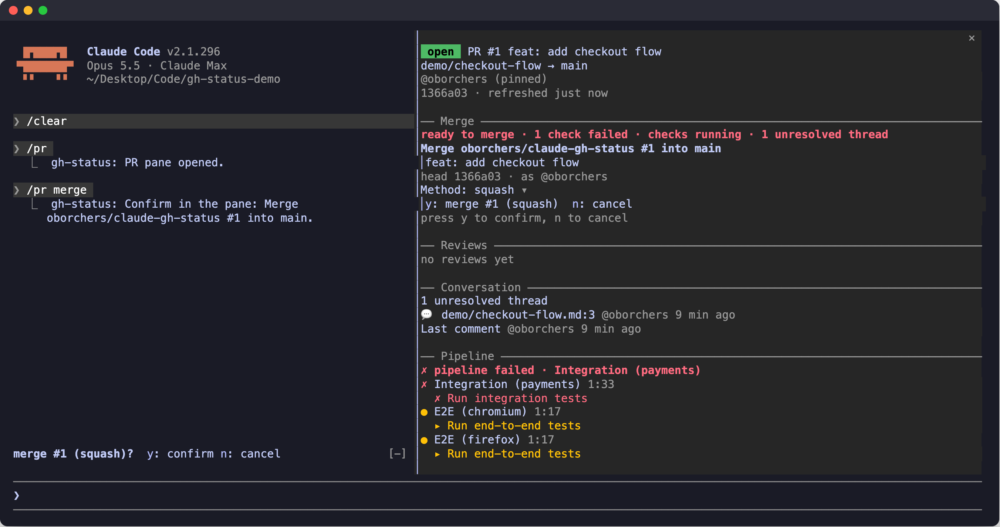
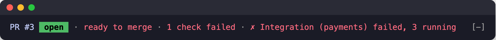
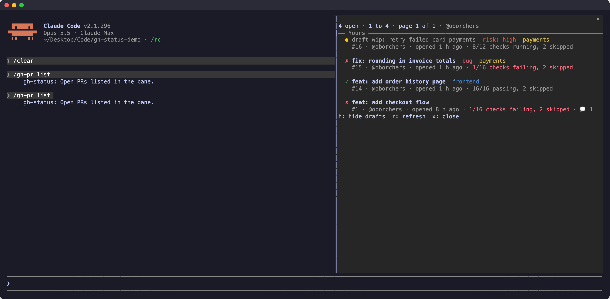
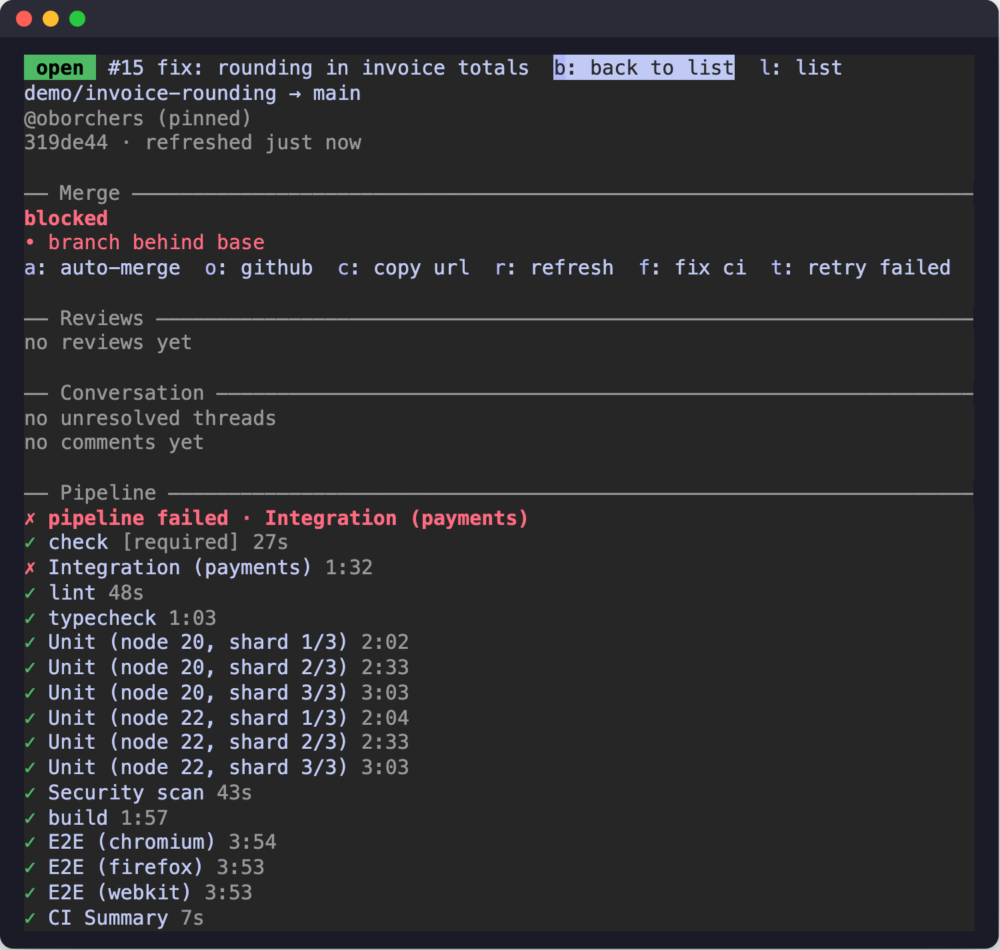

# gh-status

The pull request status of your current branch, live inside Claude Code, so you never open GitHub just to check it.



## What you see

- **A band above the prompt.** One line with the PR number, state badge, verdict, pipeline, reviews, unresolved threads and the account in use.
- **A detail pane with `/pr`.** Merge section, reviews, conversation, and the full pipeline. Comment times read `@bot 4 min ago`, or `@bot edited 2 min ago` once a comment was edited in place (review bots do that).
- **A live pipeline.** Every job with its running step, updated while checks run.
- **An honest verdict.** `ready to merge · 1 check failed` is red, it is yellow while checks run, and it is green only when everything is clean.
- **Reviews and unresolved threads.** Who approved, who asked for changes, and what is still open.
- **Merge queue.** Your position in the queue and the queue's own checks.
- **All open pull requests.** A grouped list of the repository's open pull requests, and any of them in the pane.
- **Reviews from the terminal.** Approve, request changes, or mark your own draft ready for review, each after a confirmation.
- **The right account per repository.** Personal and work repositories each use their own `gh` login, with no `gh auth switch`.

## Compact view



Below 110 columns, or outside the fullscreen layout, the pane opens inline above the prompt instead of docking beside the transcript.

## Merge without leaving the terminal



Merge, add to and remove from the merge queue, auto-merge on and off, admin merge, and the review actions all ask first. Nothing is written until you press the confirm key.

- **Confirm press.** Every write needs it, inline in the band and in the pane. Presses in the first 600 ms after a confirmation appears are ignored.
- **Bound to the head commit you saw.** Merges use `--match-head-commit`, queue and auto-merge use `expectedHeadOid`, so GitHub refuses if the branch moved.
- **Fresh re-check.** On confirm, the pull request is fetched again in full and compared: same repository, same PR, same account, same head commit, action still available. A mismatch does nothing and asks you to review again.
- **No plain merge with a merge queue.** Use add to queue, or admin merge.
- **Admin merge in two steps.** Step 1 lists the rules it bypasses, step 2 repeats them with a separate final key. If the rules changed in between, you go back to step 1.
- **Unknown results are not retried.** After a timeout or network error the confirmation is cleared and the status is refreshed.
- **Review actions follow the same rules.** Confirm press, the 600 ms guard, the fresh re-check, and the head commit as `commitOID`. A review whose result is unknown (a timeout or a server error) is never retried.
- **Merge is never offered in the list.** Picking a pull request only shows it in the pane; writes happen there.
- **No tool for the model.** Claude cannot merge through gh-status.
- `--delete-branch` and `--auto` are never used.

## The band



The band is one line above the prompt: PR number and state badge, the verdict (the first caveat such as a failed check, running checks or an unresolved thread, or blocked, in queue, auto-merge), the pipeline, reviews, unresolved threads and the account. A second row lists further blockers.

When the branch has no pull request, the band reads `no PR for <branch> · N open · N yours · N review requested` with a list button. With a pull request it shows a dim `N open` at the end of the row, dropped first when the row is tight. The counts are read every 5 minutes.

Keys, when the band has the keyboard (a key only appears when its action is available):

| Key | Does |
| --- | --- |
| `d` | Open the detail pane |
| `o` | Open the pull request on GitHub |
| `f` | Fix CI with Claude (when a check failed) |
| `m` | Merge |
| `q` | Add to the merge queue |
| `l` | Open the list of open pull requests (when the branch has no pull request) |
| `y` / `n` | Confirm / cancel a pending confirmation |

## All open pull requests



Open the list with `l` in the band (when the branch has no pull request) or in the pane, with `/gh-pr list` (`ls`), or with `/gh-pr` alone when the branch has no pull request.

- **Groups, in this order.** Yours, Review requested from you, Waiting for review, Other open.
- **Two lines per pull request.** The first has the status symbol (`✓` passing, `✗` failing, `●` running, `◷` queued), the title and the labels in a muted version of their GitHub color. The second has the number, author, age, checks, review state and comment count.
- **Pages of 10.** `n` next, `p` previous.
- **Drafts.** Draft titles are dim. `h` hides or shows them.
- **Live.** The list is read again every 60 s while it is open, and `r` refreshes now.

## Open any pull request



Pick a row in the list, or type `/gh-pr <number>`. The pane shows that pull request and marks it `(selected)`, with `b: back` to return to the branch's pull request. The band keeps showing the branch's own pull request.

Merging, the queue and the other actions act on the pull request the pane shows, with the same confirmation and bindings as for the branch's pull request. Closing the pane ends the selection.

## Review a pull request

In the pane, for the pull request it shows (the branch's or a selected one):

- `v` approve, with an optional comment.
- `w` request changes. The text is required.
- `e` ready for review, for your own drafts.

The commands are `/gh-pr approve`, `/gh-pr changes` and `/gh-pr ready`. Each opens the pane with a confirmation that shows the repository, the number, the head commit, the account and the exact text that will be posted.

- **Enter does not post.** Enter in the text field only keeps the text. Leave the field with Esc, then press `y` to post or `n` to cancel.
- **Bound to the head commit you saw.** If the branch moved, GitHub refuses the review and you are asked to look again.
- **Not offered on your own pull requests** (GitHub does not allow it), nor on drafts.

## Install

In a terminal Claude Code session:

```
/plugin install gh-status --marketplace oborchers/claude-gh-status
```

Answer `y` to add the marketplace, then pick a scope (user scope is listed first). The command works in a terminal session only.

Update:

```
claude plugin update gh-status@claude-gh-status
```

Then run `/reload-plugins` in sessions that are already running.

Requirements:

- Claude Code 2.1.290 or later
- The GitHub CLI `gh`, logged in (`gh auth login`)
- git

## Commands and keys

The command is `/pr`. If a skill or another command already uses that name in a session, the mod does not register it there and a toast says so; `/gh-pr` always works and does the same. The name can be changed with the setting `command` (Command name). Below, `/pr` stands for the active name.

| Command | Does |
| --- | --- |
| `/pr` | Open the detail pane (the list, when the branch has no pull request) |
| `/pr refresh` | Refresh now |
| `/pr open` | Open the pull request on GitHub |
| `/pr copy` | Copy the pull request URL |
| `/pr close` | Close the pane (and drop a pending confirmation) |
| `/pr list` (`/pr ls`) | Open the list of open pull requests |
| `/pr <number>` | Show that pull request in the pane |
| `/pr back` | Show the branch's pull request again |
| `/pr approve` | Ask to approve (optional comment) |
| `/pr changes` | Ask to request changes (text required) |
| `/pr ready` | Ask to mark your own draft ready for review |
| `/pr merge` (`/pr m`) | Ask to merge |
| `/pr queue` (`/pr q`) | Ask to add the PR to the merge queue |
| `/pr dequeue` (`/pr dq`) | Ask to remove the PR from the merge queue |
| `/pr auto` (`/pr a`) | Ask to turn auto-merge on, or off if it is on |
| `/pr admin` (`/pr x`) | Ask for an admin merge (two steps) |
| `/pr fix` | Put the failed CI jobs into the prompt |
| `/pr rerun` (`/pr rr`) | Re-run only the failed jobs of the failed workflow runs (no confirmation: it only starts CI again) |

Write commands (merge, queue, auto-merge, admin merge, approve, changes, ready) only ask: they open the detail pane with the keyboard and show the confirmation in its Merge section and in the band. The keyboard is granted when the prompt is empty. They tell you when an action is not available for the current PR.

Re-running covers the head commit's failed, timed-out and cancelled Actions runs, once each, with `gh run rerun <id> --failed`. A run that still has a queued or running job is skipped (GitHub refuses it), runs waiting for approval are skipped, and the merge queue's own checks are never touched. It writes nothing but a new CI attempt: no merge, no code.

Keys (a key only appears when its action is available):

| Where | Keys |
| --- | --- |
| Band | `l` list (without a pull request), `d` details, `o` open on GitHub, `f` fix CI (when a check failed), `m` merge, `q` add to queue, `t` retry failed jobs (when a failed run can be re-run) |
| List | `n` next page, `p` previous page, `h` hide or show drafts, `r` refresh, `b` back (while a pull request is selected), `x` close; click a row to open it |
| Pane | `m` merge, `q` add to or remove from queue, `a` auto-merge on or off, `x` admin merge, `v` approve, `w` request changes, `e` ready for review, `l` list, `b` back (while selected), `o` open on GitHub, `c` copy URL, `r` refresh, `f` fix CI (when a check failed), `t` retry failed jobs (when a failed run can be re-run) |
| Confirmation (band or pane) | `y` confirm (`b` for the final admin step), `n` cancel; in a review's text field, Esc leaves the field first |

Keys work while the band or pane has the keyboard: focus the band or pane with ctrl+x tab or a click. If your terminal multiplexer takes ctrl+x tab, click the band to focus it. Esc returns to the prompt. There is no separate dialog: a button press or a slash command sets the confirmation, and both the band (a one-line prompt with `y` and `n`) and the pane's Merge section (full details) show it, so whichever one holds the keyboard can answer. Cancel with `n` (or `/pr close`, or the pane's close mark); Esc alone only returns the keyboard. With several allowed merge methods the pane's confirmation shows a method selector (squash is the default if allowed).

When the repository is private and the account is not your active `gh` login, opening the pull request on GitHub also shows a hint to sign in to github.com as that account, because the browser would otherwise show a 404.

## Accounts

The account for a repository is chosen in this order:

1. The `accounts` setting for the repository owner.
2. A login pinned by a repo-local `credential.helper` that calls `gh auth token -u <login>`.
3. The login remembered from an earlier successful run for this owner.
4. The active `gh` login, if it can read the repository.
5. The other logged-in `gh` accounts on github.com, each probed for read access; the first that works is remembered.

The account's token goes only to the single `gh` child process that needs it (as `GH_TOKEN`). gh-status never runs `gh auth switch`, so your global `gh` login stays as it is. Tokens are kept in memory only.

## Settings

Shown as rows in `/config`.

| Setting | Default | Meaning |
| --- | --- | --- |
| Account per owner (`accounts`) | empty | Comma separated `owner=login` pairs, e.g. `my-org=work-login,my-user=my-user`. Wins over automatic detection. |
| Fast interval (`fastIntervalSeconds`) | 5 | Check interval while checks run or the PR is in the merge queue. |
| Idle interval (`idleIntervalSeconds`) | 30 | Check interval when nothing runs. |
| Toasts on state changes (`toasts`) | on | Show a toast when the pipeline, reviews, comments or mergeability change. |
| Command name (`command`) | `pr` | Slash command name (1 to 32 characters of a-z, 0-9 and `-`; anything else means `pr`). When it is taken in a session, for example by a skill, `/gh-pr` is used instead. |
| Color scheme (`colors`) | `claude` | `claude` follows your Claude Code theme; `github` uses GitHub's Primer colors. |

## Live updates and rate limits

- While checks run or the PR is in the merge queue, gh-status checks every 5 s (the fast interval); otherwise every 30 s (the idle interval). With no open PR it checks every 120 s.
- The check is a set of conditional REST requests (ETag). A `304 Not Modified` answer does not count against the REST rate limit.
- When something changed, or at least every 60 s, it runs a full GraphQL refresh, which costs 2 points.
- When fewer than 500 points remain, polling slows to at most once a minute.
- It also refreshes immediately after `git push`, `pull`, `checkout`, `switch`, `rebase`, `merge`, `commit`, `reset` and `gh pr` or `gh run` commands run by Claude, when a turn ends, when the working directory changes, and on `/pr`.
- Job details for the pane are fetched only while the pane is open.
- While the list is open it is read every 60 s (about 3 points per read). The counts in the band are read every 5 minutes (1 point). Both slow to at most once every 5 minutes when fewer than 500 points remain.
- A short toast announces changes in the pipeline, reviews, comments or mergeability (setting `toasts`).

## Limits

- GitHub does not push events, so the status is polled. Changes show up within the check interval.
- Nothing is drawn in VS Code's chat panel, in `-p` runs or in cloud sessions.
- Branch protection details need admin rights on the repository.
- At most 100 checks per commit are read.
- Only github.com remotes are supported.

## Development

```
claude --plugin-dir <path>      # load from disk, hot reload on save
claude plugin validate .
tsc -p .
claude plugin test .
```

To refresh the screenshots in `docs/images`, use the demo skill in `.claude/skills/gh-status-demo`. It sets up a demo pipeline, branch and pull request, and the terminal layouts for the tab and compact views.

Architecture:

- `hooks/register.tsx` is the only file that touches `$` (the engine interface); it wires commands, hooks and state.
- `src/*.ts` modules are pure and receive their effects (`gh`, git, state, time, toasts) as injected functions.
- `src/ui/*.tsx` draws the band and the pane (with its inline confirmation) from a view built by `register.tsx`.
- The state contract lives in `types/index.d.ts`.
- Tests are in `tests/`.

## License

MIT, see [LICENSE](LICENSE).
